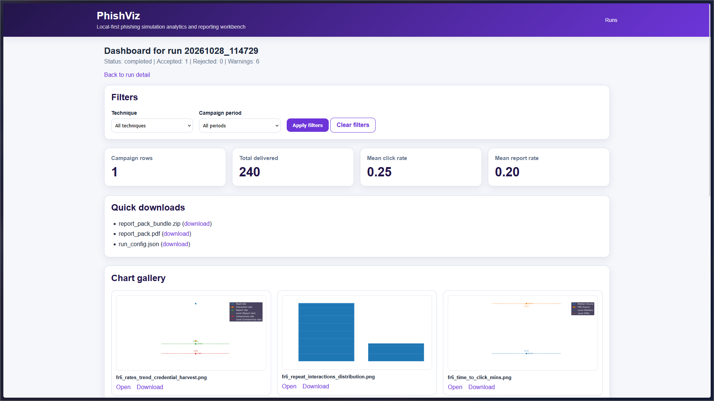
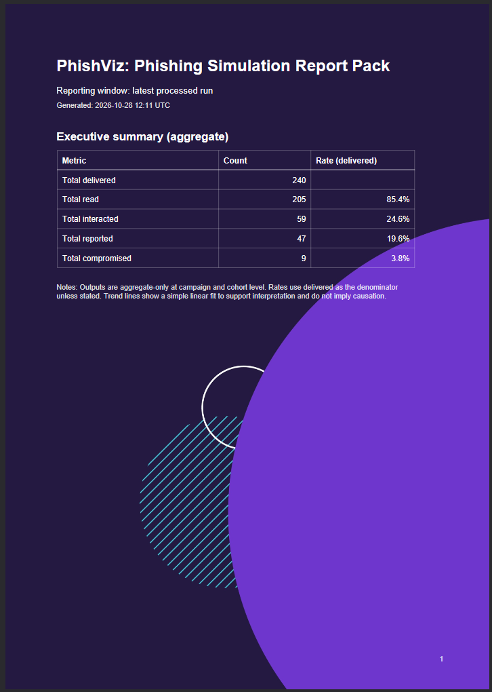

# PhishViz

**Local-first phishing simulation analytics and reporting workbench**

**University of South Wales — BSc (Hons) Digital and Technology Solutions (Cyber Security), Capstone Project (2025–2026)**

PhishViz is a Python and Django application for analysing CSV exports from **Microsoft Defender for Office 365 Attack Simulation Training (AST)**. It ingests and normalises results, pseudonymises direct identifiers, calculates aggregate behavioural metrics, creates charts and PDF reports, and records the information needed to verify or reproduce a run.

The project provides both a command-line pipeline and a browser-based workflow running locally. It was developed as a university capstone project to explore repeatable phishing-simulation reporting, **not** as a production-ready or externally hosted security platform.

## Screenshots

### Analysis dashboard



### Generated PDF report



## Features

| Area                                   | Functionality                                                                                                  |
| -------------------------------------- | -------------------------------------------------------------------------------------------------------------- |
| **FR1–FR3: Ingestion and preparation** | Validate AST Results CSV exports; normalise data; pseudonymise direct identifiers using a local secret salt.   |
| **FR4: Behavioural metrics**           | Campaign-level delivery, click, submission and report metrics; time-to-event and repeat-interaction summaries. |
| **FR5: Cohort comparison (optional)**  | Produce cohort A/B comparison and trend outputs when suitable configuration and data are provided.             |
| **FR6: Visualisation**                 | Generate static PNG charts with an accompanying manifest.                                                      |
| **FR7: Reporting**                     | Export a PDF report pack and supporting ZIP bundle.                                                            |
| **FR8: Provenance**                    | Save configuration, input fingerprints and output manifests; verify and reproduce prior runs.                  |
| **Django interface**                   | Upload inputs, launch analyses, inspect dashboards, download artefacts and manage local runs.                  |

With the same secret salt, identifiers can be consistently pseudonymised across campaigns. **Pseudonymisation is not anonymisation**, and neither raw exports nor pseudonymised outputs should automatically be treated as safe for public release.

## Try it with synthetic data

A sample AST Results-format CSV is provided in [`examples/`](examples/). Its participants, addresses, events and timestamps are **entirely fictional**. It is intended to let someone test the application without access to real employee, employer or client data.

The public sample demonstrates a single campaign, so **leave cohort comparison disabled** for the initial run.

## Requirements

- **Windows** with PowerShell (the environment used to develop and test this version).
- **Python 3.12** recommended.
- Packages specified in `requirements.txt`.
- A local-only environment; do not expose the development server to the internet.

Git is useful for development, but is not needed to run a downloaded copy of the project.

## Installation (PowerShell)

Run these commands from the **repository root**.

### 1. Create the Python environment

```powershell
py -3.12 -m venv .venv
.\.venv\Scripts\python.exe -m pip install -r requirements.txt
```

### 2. Set up local secrets

The application uses `PHISHVIZ_HASH_SALT` when pseudonymising identifiers. Django also uses `DJANGO_SECRET_KEY`. Generate **two distinct** random values; never use the example placeholders as real secrets.

Create a local `.env` file without printing the generated secrets:

```powershell
$bytes1 = New-Object byte[] 32
$bytes2 = New-Object byte[] 32
$rng = [System.Security.Cryptography.RandomNumberGenerator]::Create()
$rng.GetBytes($bytes1)
$rng.GetBytes($bytes2)
$rng.Dispose()

$hashSalt = [Convert]::ToBase64String($bytes1)
$djangoKey = [Convert]::ToBase64String($bytes2)
@(
    "PHISHVIZ_HASH_SALT=$hashSalt"
    "DJANGO_SECRET_KEY=$djangoKey"
    "PHISHVIZ_DEBUG=True"
) | Set-Content -Path .env -Encoding ascii

Remove-Variable bytes1, bytes2, hashSalt, djangoKey
```

The tracked `.env.example` file documents these settings but **must not contain real secrets**. Keep your real `.env` local and ignored by Git. If a salt is changed, previously generated pseudonymous identifiers may no longer match new runs.

### 3. Create the local working directory

```powershell
New-Item -ItemType Directory -Force workspace | Out-Null
```

The directory is used by the local Django database and uploaded run files. It must not be committed to Git.

## Run the web application

From the repository root:

```powershell
.\.venv\Scripts\python.exe launch_phishviz.py
```

The launcher applies Django database migrations, starts the development server and opens **http://127.0.0.1:8000/**. If the browser does not open automatically, visit that address manually.

Typical browser workflow:

1. Select **Create new run**.
2. Upload the synthetic CSV from `examples/` and provide an optional run label.
3. Leave cohort mode **off** for the single-campaign demo, then start the analysis.
4. Review the run summary, accepted inputs, warnings and downloadable artefacts.
5. Select **Open dashboard** to examine metrics and visualisations.
6. Select **Verify run** to check the saved input/configuration provenance.
7. If verification passes, select **Reproduce this run** to create another run from the saved inputs and configuration.

Stop the server using **Ctrl+C** in the terminal. This is Django's local development server, not a production deployment.

## Run the command-line pipeline

The command-line workflow reads CSVs from `ast_exports/raw/` by default. Copy the synthetic example there as an **ignored local working copy**:

```powershell
New-Item -ItemType Directory -Force 'ast_exports/raw' | Out-Null
Copy-Item 'examples/*.csv' 'ast_exports/raw/'
.\.venv\Scripts\python.exe PhishViz.py
```

The output is written into a new `out/run_<timestamp>/` directory. Run `PhishViz.py --help` to see the available options, including input/output paths and reproduction from a saved run configuration.

## Repository layout

The public-facing project consists of reviewed code and synthetic example data:

```text
phishviz/
├── etl/                     # Ingestion, normalisation, metrics, charts and reporting
├── web/                     # Django UI, models, templates and migrations
├── config/
│   └── cohorts.json         # Safe configuration for the demo
├── examples/                # Entirely synthetic AST Results-format CSV
├── PhishViz.py              # Command-line entry point
├── launch_phishviz.py       # Local Django launcher
├── requirements.txt
├── .env.example             # Configuration template; no real secrets
├── .gitignore
└── README.md
```

The following are created or used **locally** and intentionally excluded from version control:

- `.env`, `.venv/` and Python caches;
- `ast_exports/` (input exports, including real data if independently authorised);
- `workspace/` (uploaded files and SQLite database);
- `out/` (charts, metrics, PDFs, bundles and run metadata).

Do not copy files from an older project history into this repository without reviewing them. Use the synthetic data from `examples/` for demonstrations.

## Outputs and analysis

Each successful analysis may generate:

```text
out/run_<timestamp>/
├── fr4_campaign_metrics.csv
├── fr4_repeat_metrics.csv
├── fr4_time_metrics.csv
├── charts/
│   ├── *.png
│   └── manifest.csv
├── report_pack.pdf
├── report_pack_bundle.zip
└── run_config.json
```

Additional FR5 cohort metrics and charts are produced **only when cohort mode is configured and enabled**. Exact chart names and the set of outputs can vary by run and input data.

### Provenance, verification and reproduction

`run_config.json` records information such as input file references, SHA-256 fingerprints, configuration snapshots and generated output manifests. The **Verify run** action checks whether the referenced inputs still match the saved record; **Reproduce this run** executes a new analysis using saved inputs and configuration.

Verification is a consistency check, not proof that external data are authentic or free from errors. Reproduction also depends on the availability of the referenced files and compatible software.

## Privacy and security

- The supplied `examples/` file is synthetic; **never publish genuine AST exports** or data derived from identifiable users without proper authorisation and review.
- Do not commit `.env`, `workspace/`, `ast_exports/`, `out/`, local databases, secrets, customer materials or confidential assets.
- `.gitignore` only prevents normally ignored files from being newly added; it **does not erase files from existing Git history**.
- The Django interface has no production authentication/deployment setup. Bind it to the local loopback interface only and do not expose it publicly.
- Treat pseudonymous outputs as potentially sensitive data and protect the local hash salt.
- This project is an educational and portfolio artefact, not an audited enterprise security product.

## Troubleshooting

| Problem                                   | What to check                                                                                                                |
| ----------------------------------------- | ---------------------------------------------------------------------------------------------------------------------------- |
| `PHISHVIZ_HASH_SALT` missing or too short | Generate a sufficiently long random salt in the root `.env`; restart the process and keep the salt out of Git.               |
| Python or package installation fails      | Check the selected Python version, recreate `.venv` if needed and install dependencies again from `requirements.txt`.        |
| Django fails during migrations            | Ensure the local `workspace/` folder exists and is writable.                                                                 |
| Browser does not open                     | Check the launcher terminal and manually visit http://127.0.0.1:8000/.                                                       |
| No inputs processed                       | Check that you uploaded a supported AST Results-format CSV or copied the synthetic file into `ast_exports/raw/` for CLI use. |
| Run completes with ingestion warnings     | Read the warnings and validate the metrics; successful execution does not imply warning-free data.                           |
| Verification fails                        | Confirm saved input files and configuration still exist and have not changed.                                                |
| Charts or PDF missing                     | Check the run's artefacts and terminal errors, and confirm dependencies were installed.                                      |

## Scope and limitations

PhishViz currently provides a local CLI, a local Django browser interface, reporting outputs, provenance verification and run reproduction. It does **not** include a standalone installer, frozen executable, hosted multi-user service, direct AST API integration or enterprise authentication.

## Author

**Ieuan Phillips**
Developed as a capstone project for the **BSc (Hons) Digital and Technology Solutions (Cyber Security)** degree at the **University of South Wales**.

No open-source licence is implied by this README; publication and reuse permissions should be confirmed before adding a licence.
